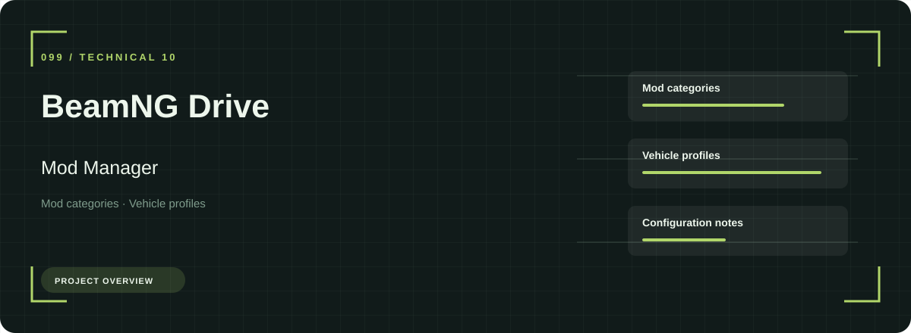
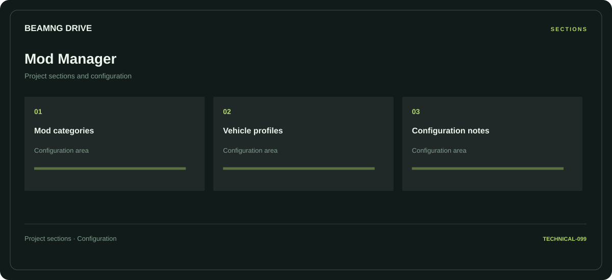

# 🧭 BeamNG Drive Mod Manager

**Mod categories · Vehicle profiles · Configuration notes**

## ⚡ Features

Mod categories, vehicle profiles, and configuration notes form the core of BeamNG Drive Mod Manager. Related configuration is grouped by task rather than collected in an undifferentiated list.

### ⚙️ Mod categories

Content and resource groups, together with their configuration or organization details.

### 🧩 Vehicle profiles

Related settings collected into named groups for a clearer configuration workflow.

### ⌨️ Configuration notes

A dedicated section for configuration notes and the configuration details associated with that area.

## 🖥️ Project navigation

## 📥 Download

The button and cover open the project's download page. Use the information supplied with the downloaded package for installation and release-specific requirements.

## 📚 Project documentation

- [Feature reference](docs/FEATURES.md)
- [Download information](docs/DOWNLOAD.md)
- [Project page](index.html)

---

BeamNG Drive Mod Manager · Program documentation and download information.
